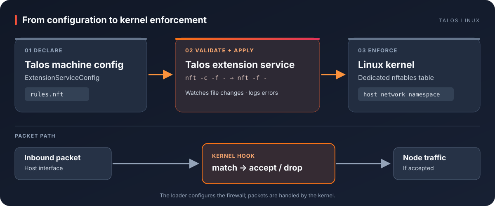

<p align="center"><a href="https://www.siderolabs.com/talos-linux"></a></p>
<h1 align="center">talos-nftables</h1>
<p align="center"><strong>Native nftables policy for Talos Linux hosts, independent of Kubernetes.</strong></p>
<p align="center">
  <a href="https://github.com/samr037/talos-nftables/actions/workflows/ci.yml"></a>
  <a href="https://github.com/samr037/talos-nftables/releases"></a>
  <a href="LICENSE"></a>
</p>
<p align="center"><a href="#how-it-works">How it works</a> · <a href="#try-the-lab">Try the lab</a> · <a href="#test-results">Test results</a> · <a href="#deploy">Deploy</a></p>

---

Talos has a [native ingress firewall](https://docs.siderolabs.com/talos/v1.13/networking/ingress-firewall) for ordinary host access rules. This community extension adds the full nftables language when a policy needs raw-priority hooks, packet-header expressions, sets, rate limits, NAT, or counters. It loads a rules file from Talos machine configuration into the host network namespace.

> [!IMPORTANT]
> The rules file is trusted administrator input with host firewall privileges. Give this extension its own nftables table. Never use `flush ruleset`, which would also remove rules owned by Talos and other networking components.

## How it works



1. A custom Talos boot image carries the extension service, `nft`, and its libraries.
2. `ExtensionServiceConfig` mounts your policy as `/etc/nft-rules/rules.nft`.
3. The service validates the exact file with `nft -c -f -`, then applies it with `nft -f -`. It watches for changes and logs diagnostics through `talosctl logs ext-nft-rules`.
4. The kernel enforces the rules. The loader is never in the packet path.

Rules are restored after reboot when the service starts. A syntax error during an update leaves the previously installed table active. [Design and safety details →](docs/design.md)

## Try the lab

The reproducible lab boots Talos v1.13.3 ARM64 in a small QEMU VM on Apple Silicon: **2 vCPU, 2 GiB RAM, sparse 10 GiB disk**. It needs Docker, QEMU, `talosctl`, `zstd`, Go, and Python 3. Generated credentials and disks stay in ignored `_out/`.

```bash
./lab/build.sh
./lab/run.sh       # keep this terminal open
```

In another terminal:

```bash
./lab/check.sh
```

The lab policy in [examples/ipv4-options.nft](examples/ipv4-options.nft) drops IPv4 TCP packets with IP options. `check.sh` sends one crafted packet and asserts that the rule's drop counter increases. This is a **test policy**, not a recommended default firewall. [Apple Silicon lab guide →](docs/lab.md) · [AMD64 Proxmox lab guide →](docs/lab-amd64.md)

## Test results

| Check | How to reproduce | Observed result |
| :--- | :--- | :--- |
| Loader unit tests | `make test` | Validation precedes application; invalid input preserves the last applied policy. |
| Static analysis and both image architectures | [GitHub Actions CI](https://github.com/samr037/talos-nftables/actions/workflows/ci.yml) | `go vet` and AMD64/ARM64 image builds pass. |
| ARM64 Talos VM | `./lab/build.sh`, `./lab/run.sh`, then `./lab/check.sh` | Extension service starts before Kubernetes readiness; the table returns after reboot. |
| AMD64 Talos VM | [Proxmox lab](docs/lab-amd64.md) | Published v0.1.1 image boots; the rule loads and returns after reboot. |
| Packet match | `./lab/check.sh` on both architectures | A crafted 44-byte IPv4 TCP packet with an IP option raised the drop counter from 0 to 1. |
| Bad rule update | [ARM64](docs/lab.md#recorded-result-2026-11-06) and [AMD64](docs/lab-amd64.md#recorded-result-2026-11-07) test records | `nft -c` rejected invalid syntax; the previous kernel table remained active. |

Packet test excerpt from the Talos VM:

```text
meta l4proto tcp ip hdrlength > 5 counter packets 0 bytes 0 drop
sent 44-byte IPv4 TCP packet with IHL=6 to 10.0.2.15
meta l4proto tcp ip hdrlength > 5 counter packets 1 bytes 44 drop
PASS: IPv4 options counter increased (0 -> 1)
```

Both VM and packet tests ran on **Talos v1.13.3**: ARM64 on an Apple Silicon laptop and AMD64 on Proxmox. Neither lab bootstrapped Kubernetes; they verify the pre-Kubernetes service and host packet path.

## Deploy

Use the published image `ghcr.io/samr037/talos-nftables:v0.1.1`, or build your own with `make image-push`. Custom extensions must be included in a Talos boot asset or installer using [Talos imager](https://docs.siderolabs.com/talos/v1.13/platform-specific-installations/boot-assets#imager); adding a machine config document alone cannot install an extension. The public Image Factory supports official extensions only.

Add [examples/extension-service-config.yaml](examples/extension-service-config.yaml) to the machine configuration and replace its demonstration policy with your own table and rules. Then verify:

```bash
talosctl -n NODE get extensions
talosctl -n NODE service ext-nft-rules
talosctl -n NODE logs ext-nft-rules
```

[Installer build and rollout →](docs/deployment.md) · [Updating rules and recovery →](docs/operations.md)

## Project

This is an independent community project, not an official Sidero Labs extension. The Talos Linux logo belongs to Sidero Labs and is loaded from its [official documentation repository](https://github.com/siderolabs/docs/blob/main/public/images/talos.svg) for identification. Code is MIT licensed; see [LICENSE](LICENSE).
